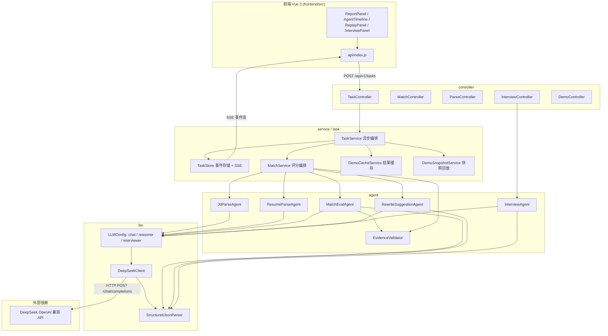
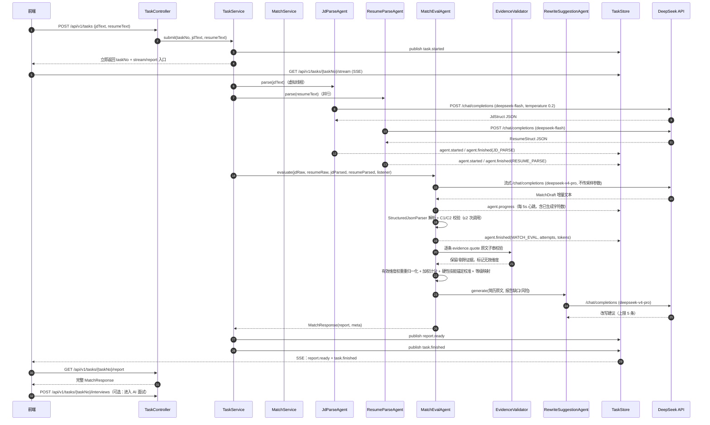
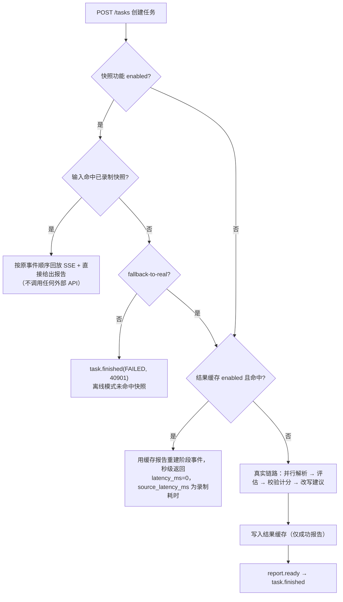
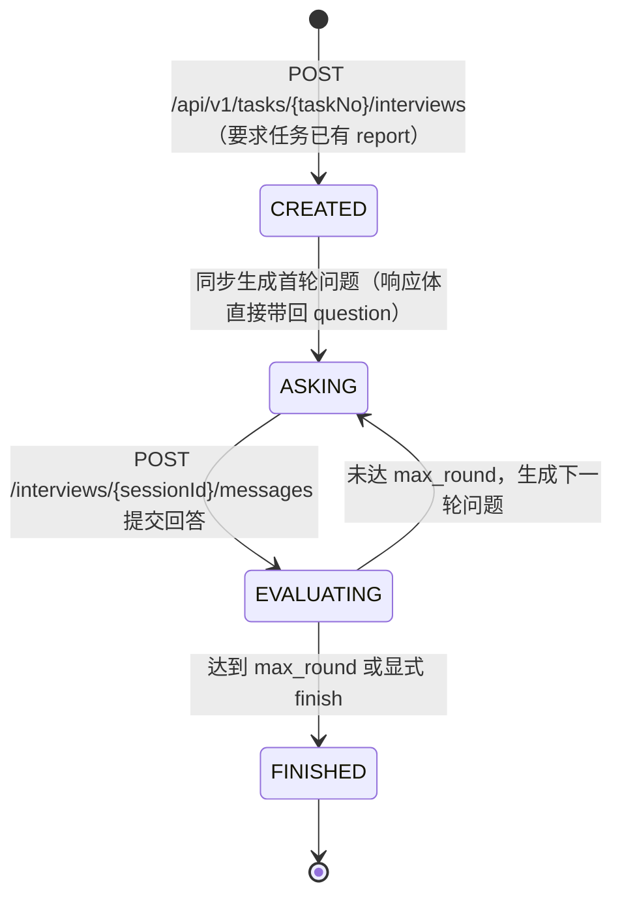

# OfferPilot 架构说明

本文档描述 OfferPilot 当前代码的真实分层、核心链路、评分与容错机制。所有内容均以仓库内源码与配置为准（`backend/src/main/java/com/offerpilot`、`backend/src/main/resources/application.yml`、`frontend/src`），不含未实现的设计设想。

---

## 1. 系统概览

OfferPilot 是一个「JD（职位描述）—简历」匹配分析平台：输入 JD 与简历原文，由多个 LLM Agent 依次完成结构解析、匹配评估、证据校验与计分、改写建议，最终产出可解释的匹配报告；在此基础上提供模拟面试会话与离线演示能力。

| 层次 | 技术选型 | 说明 |
|---|---|---|
| 前端 | Vue 3 + Vite + Element Plus | `frontend/src`，构建产物由 `npm run build` 输出到 `frontend/dist`，打包时并入后端静态资源 |
| 后端 | Spring Boot 3.2.12 / Java 21 | `com.offerpilot`，虚拟线程执行异步任务 |
| 大模型 | DeepSeek（OpenAI 兼容 `/chat/completions`） | `llm` 包，模型分档：`deepseek-flash`（解析）/ `deepseek-v4-pro`（评估、改写、面试） |
| 传输 | REST + SSE | 任务创建/查询用 REST，进度用 SSE 事件流 |
| 测试 | JUnit 5 + Mockito + JaCoCo | `backend/src/test/java/com/offerpilot` |

---

## 2. 分层结构

```
backend/src/main/java/com/offerpilot
├── OfferPilotApplication.java   # 启动类
├── controller/                  # 接口层：参数校验、响应包装、异常映射
│   ├── TaskController            # POST /api/v1/tasks、GET /{taskNo}、/{taskNo}/events、/{taskNo}/report
│   ├── MatchController           # POST /api/match
│   ├── ParseController           # POST /api/parse/jd、/api/parse/resume
│   ├── InterviewController       # 面试会话系列接口（见 §9）
│   ├── DemoController            # /api/v1/demo 缓存与快照管理
│   ├── HealthController          # GET /api/health
│   └── SseController             # GET /api/analysis/events（早期占位心跳实现）
├── task/                        # 任务编排与事件存储
│   ├── TaskService               # 异步编排：快照回放 → 缓存命中 → 真实链路
│   ├── TaskStore                 # 任务注册表 + SSE 订阅者管理 + 心跳调度
│   ├── AnalysisTask              # 任务状态实体（状态、进度、结果、token、耗时）
│   ├── TaskEvent                 # 单条 SSE 事件（seq、name、data、时间偏移）
│   └── ProgressListener          # Agent 进度回调接口（NOOP 空实现）
├── service/
│   ├── MatchService              # 核心编排：并行解析 → 评估 → 证据校验 → 计分 → 改写建议
│   ├── DemoCacheService          # 结果缓存（内存 LRU + 磁盘 JSON）
│   └── DemoSnapshotService       # 演示快照录制与回放
├── agent/                       # LLM Agent 层（每个 Agent 一个职责）
│   ├── AbstractParseAgent        # 解析类 Agent 抽象基类（温度、重试、指标）
│   ├── JdParseAgent / ResumeParseAgent
│   ├── MatchEvalAgent            # 匹配评估（推理模型，流式消费）
│   ├── RewriteSuggestionAgent    # 简历改写建议（最多 5 条）
│   ├── InterviewAgent            # 面试官（出题 / 评分）
│   ├── EvidenceValidator         # 证据原文校验（反幻觉）
│   ├── PromptTemplate            # classpath:prompts/{agent}.{version}.txt 模板渲染
│   └── AgentResult               # Agent 统一返回（数据 + 耗时 + token + 重试元数据）
├── llm/                         # 模型访问层
│   ├── DeepSeekClient            # JDK HttpClient 实现，超时/重试/token 解析/流式
│   ├── LLMConfig                 # 三个模型 Bean：chatModel / reasonerModel / interviewerModel
│   ├── StructuredJsonParser      # 从原始文本抽取 JSON 并反序列化
│   └── ChatRequest / ChatResponse
├── interview/                   # 模拟面试会话域
│   ├── InterviewService / InterviewAgent 调用编排
│   ├── InterviewSessionStore     # 会话内存表 + Jackson 落盘 + 启动恢复
│   ├── InterviewSnapshotService  # 面试链路快照录制/回放
│   └── InterviewSession / InterviewTurn / InterviewSessionRecord
├── dto/                         # 请求/响应与模型输出草稿（JdStruct、ResumeStruct、MatchDraft、MatchReport、MatchResponse 等）
├── common/                      # ApiResponse、ErrorCode
└── config/                      # CorsConfig
```

分层职责约束：

- **controller** 只做参数校验、调用 service、包装 `ApiResponse`，不含业务判断；
- **service** 负责编排与业务规则（评分、归一化、缓存、快照），不直接拼装 HTTP 语义；
- **agent** 只负责「构造 Prompt → 调模型 → 解析结构化输出 → 自我纠错重试」，不感知任务与事件；
- **llm** 只负责模型通信与 JSON 抽取，不含业务规则。

---

## 3. 架构图



---

## 4. 核心链路时序

主链路：**JD 解析 → 简历解析（与 JD 并行）→ 匹配评估 → 证据反幻觉校验与计分 → 改写建议 → 报告就绪**，随后进入可选的 **AI 面试**阶段。



链路关键约束（对应源码）：

- 两个解析 Agent 之间无数据依赖，可并行；`offerpilot.latency.overlap-parse-eval` 控制「评估是否与解析软重叠」，默认 `false`，即评估严格等两个解析完成后再启动（`TaskService`/`MatchService`）。
- `MatchEvalAgent` 使用推理模型且**不传采样参数**（`chatNoSampling` / `chatStreamNoSampling`），避免推理结果被温度扰动。
- 全部事件发布顺序固定，`TaskStore` 为每个任务维护单调递增 `seq`，保证前端时间线顺序稳定。

---

## 5. 大模型调用与模型分级

`LLMConfig` 依据 `application.yml` 的 `deepseek.*` 配置构造三个 `DeepSeekClient` Bean：

| Bean | 使用方 | 模型 | 读取超时 | 重试 |
|---|---|---|---|---|
| `chatModel` | `JdParseAgent`、`ResumeParseAgent` | `deepseek-flash` | 60s（`timeout.chat-seconds`） | 1 次 |
| `reasonerModel` | `MatchEvalAgent`、`RewriteSuggestionAgent` | `deepseek-v4-pro` | 180s（`timeout.reasoner-seconds`） | 1 次 |
| `interviewerModel` | `InterviewAgent` | `deepseek-v4-pro` | 60s（`timeout.interview-seconds`） | **0 次**（`maxAttempts=1`） |

`DeepSeekClient` 的实现要点：

- 基于 JDK 原生 `HttpClient`，连接超时 10s，读取超时按 Bean 传入；
- 请求体为 OpenAI 兼容的 `model` + `messages` + `temperature`，解析响应中的 `choices[0].message.content` 与 `usage`（prompt / completion / total tokens）；
- 支持一次性调用（`chat` / `chatNoSampling`）与 SSE 流式调用（`chatStream` / `chatStreamNoSampling`，逐 `delta` 回调）；
- 失败重试 1 次；面试链路显式禁用重试，避免「超时 → 立即重发」把单轮最坏耗时从 60s 翻倍到 120s。

`PromptTemplate` 以 `classpath:prompts/{agent_name}.{version}.txt` 加载提示词，变量占位符为 `{{var}}`，渲染后拼接用户内容。

---

## 6. JSON 容错机制

模型输出不可靠，链路上有三层防护：

**第一层：抽取（`StructuredJsonParser.extractJson`）**
先剥离 Markdown 代码块围栏（```json ... ```），再截取首个 `{` 到最后一个 `}`，容忍前后多余说明文字；反序列化时忽略未知字段（`FAIL_ON_UNKNOWN_PROPERTIES=false`），字段缺失不报错。

**第二层：校验与回传重试（`MatchEvalAgent`）**

| 条件 | 触发动作 |
|---|---|
| C1：JSON 反序列化/字段校验失败 | 捕获 `IllegalArgumentException`，把错误信息作为「重试反馈」拼进下一轮 Prompt |
| C2：`uncertainty=true` 或「有效证据维度数 < 维度总数」，且 `uncertainty + 缺证据维度 > 总数 / 5` | 判定为「整体不确定」，同样携带反馈重试 |
| 总调用次数 | 上限 `MAX_ATTEMPTS = 2`（首轮 + 1 次重试），仍失败则抛出，由 `TaskService` 转 `task.finished(status=FAILED, error_code=40501)` |

**第三层：元数据留痕**
`AgentResult` 与 `MatchResponse.meta` 记录 `attempts`、`retried`、`retryReason`、各阶段 `promptTokens/completionTokens/totalTokens` 与 `elapsedMs`（含重试累计）。`RewriteSuggestionAgent`、`InterviewAgent` 复用同一套「解析失败 → 反馈重试」策略。

**第四层：证据兜底**
证据条目还要过 `EvidenceValidator`（§8），即使 JSON 结构合法，无法在原文定位的 quote 也会被剔除，不进入计分。

---

## 7. 五维评分与权重重归一化

评分策略固定写在 `MatchService.POLICY`（权重之和 = 100，列表顺序即报告维度顺序），模型只输出 0–10 的维度原始分（`RAW_MAX = 10`），不输出权重、维度得分、总分与等级：

| 维度 | 权重 | 说明 |
|---|---|---|
| 硬性技能匹配 | 30 | 校准锚点维度 |
| 经验年限与职级 | 20 | |
| 项目与成果相关度 | 25 | |
| 教育与证书 | 10 | |
| 加分项与潜力 | 15 | |

计分步骤：

1. **维度得分** = `rawScore / RAW_MAX × weight`（`rawScore` 裁剪到 0–10）。
2. **证据校验剔除**：某维度证据全部无法在原文定位 → 该维度记为 `invalidDimensions`，不参与总分。
3. **权重重归一化**：设有效维度权重和 `validWeightSum`、有效维度得分和 `validScoreSum`，
   `五维加权原始分 = round1(validScoreSum / validWeightSum × 100)`；当 `validWeightSum < 100 - 0.001` 时 `meta.renormalized = true`，即总分只由有效维度决定，避免「缺维度 = 白送分」或「缺维度 = 直接判低」。
4. **硬性技能锚定校准**（`offerpilot.match-calibration.enabled=true`）：
   `校准总分 = round1(α × 五维加权原始分 + β × 硬性技能原始分 × 10)`，默认 `α = 0.7`、`β = 0.3`。当硬性技能维度缺失或被剔除时，校准不生效，直接使用五维加权原始分。
5. **等级映射**（`MatchService.level`，阈值从配置注入）：

| 场景 | 高度匹配 | 较匹配 | 一般 | 不匹配 |
|---|---|---|---|---|
| 校准生效（`threshold`） | ≥ 81 | 47 ~ 81 | 20 ~ 47 | < 20 |
| 校准未生效（`fallback-threshold`） | ≥ 80 | 60 ~ 80 | 40 ~ 60 | < 40 |

总分与等级全部由服务端计算，`MatchDraft`（模型侧草稿）刻意不含这些字段，保证「评分可解释、不可被模型直接指定」。

---

## 8. 证据反幻觉校验

`EvidenceValidator` 是链路中的防幻觉闸门，对每条 `evidence`（`source` 为 `jd` / `resume`，`quote` 为模型声称的原文摘抄）做原文子串校验：

- **归一化**：忽略空白字符、全角/半角差异、中英文标点差异、大小写差异后再比较，避免因排版与标点导致误杀；
- **定位**：归一化后的 `quote` 必须是对应原文（`jdRaw` 或 `resumeRaw`）的子串，否则判定为无效证据；
- **影响范围**：无效证据被剔除；某维度有效证据为 0 → 维度标记 `uncertainty` 并计入 `invalidDimensions`，进而触发权重重归一化；`hits[].resumeQuote`、`risks[].evidenceRef` 同样走该校验（无法定位的命中条目被丢弃，`meta` 中可观察丢弃情况）。

因此报告中的每条证据都可以在用户提供的原文中检索到，不会出现「模型编造的项目经历」。

---

## 9. 离线快照回放与结果缓存

`TaskService.run()` 的执行顺序体现了「演示优先、真实兜底」的降级链：



- **结果缓存 `DemoCacheService`**：缓存键 = `SHA-256(JD 原文摘要 + 简历原文摘要 + 模型档位 + 缓存版本)`（当前 `CACHE_VERSION = s7-v2`）；内存 `LinkedHashMap(accessOrder=true)` 实现 LRU（上限 `max-entries=200`），同时以 JSON 落盘到 `demo-cache/`，进程重启后仍可复用；只缓存通过校验的完整报告，开关 `offerpilot.demo.cache.enabled`。
- **演示快照 `DemoSnapshotService`**：录制内容为「输入摘要 + 模型 + 端到端耗时 + token 总量 + 完整报告 + 全部 SSE 事件（含相对时间偏移）」，落盘为 `demo-snapshots/*.json`；回放时按原始顺序重发事件，事件间隔按 `speed=0.05`（约压缩 20 倍）缩放，单事件间隔上限 `max-gap-ms=1200`，避免长停顿；若快照缺少 `task.finished` 则兜底补发。相关接口：`GET /api/v1/demo/status`、`GET /api/v1/demo/snapshots`、`POST /api/v1/demo/snapshots/record`、`POST /api/v1/demo/snapshots/reload`。
- **离线演示启动参数**：演示包启动脚本以 `--offerpilot.demo.snapshot.enabled=true --offerpilot.demo.snapshot.fallback-to-real=false --offerpilot.demo.cache.enabled=true` 启动，因此演示过程完全不依赖外部 API Key。

---

## 10. SSE 事件流

`TaskStore` 承担事件存储与订阅分发：

- 每个事件带任务内单调递增 `seq`，写入 SSE `id` 字段；客户端重连带 `Last-Event-ID` 时只补发 `seq > lastEventId` 的事件，避免重复渲染；
- 全局心跳 `heartbeat`（`offerpilot.latency.heartbeat-seconds`，默认 15s，仓库配置为 5s）不带 `id`，不污染 `Last-Event-ID` 语义；
- 评估 Agent 执行期间按 `agent-progress-seconds`（仓库配置 5s）推送 `agent.progress`（含 `agent_name`、`elapsed_ms`，流式模式还带已生成字符数），避免用户误判卡死。

| 事件名 | 关键字段 | 触发时机 |
|---|---|---|
| `task.started` | `total_agents` | 任务开始 |
| `agent.started` | `agent_name`、`model` | 单个 Agent 开始（`JD_PARSE`、`RESUME_PARSE`、`MATCH_EVAL`） |
| `agent.progress` | `agent_name`、`elapsed_ms` | 长任务心跳 |
| `agent.finished` | `agent_name`、`latency_ms`、`retried`、`attempts`、`total_tokens` | Agent 完成 |
| `agent.failed` | `agent_name`、`error_code`、`retry_count` | Agent 最终失败 |
| `report.ready` | `overall_score`、`level`、`report_url`、`cache_hit` | 报告可用 |
| `task.finished` | `status`、`token_total`、`duration_ms` | 任务终态（成功/失败） |
| `heartbeat` | 时间戳 | 固定间隔保活 |

读取接口：`GET /api/v1/tasks/{taskNo}/stream`（实时 SSE）、`GET /api/v1/tasks/{taskNo}/events`（历史事件回放，支持 `Last-Event-ID`）。`GET /api/analysis/events`（`SseController`）为早期阶段留下的占位心跳实现，与主链路无关。

---

## 11. 模拟面试（面试会话域）

面试建立在已完成的匹配报告之上，会话状态机如下：



实现要点：

- `InterviewService.start()` 校验任务存在且报告就绪，轮次由 `clampRound` 限制在 `interview.max-round-limit=5` 以内（默认 `default-max-round=3`）；报告、JD 与简历原文随会话持久化，使得进程重启后 `answer`/`finish` 仍可脱离 `TaskStore` 续传；
- 每轮串行：写入 `transcript` → 生成评估 → 决定下一题或收尾（评分 + 总结），单轮模型调用禁用重试以守住 60s 硬超时；
- `InterviewSessionStore` 以 Jackson 落盘 `data/session/`，启动自动恢复；`InterviewSnapshotService` 录制/回放面试事件序列（`snapshot-dir=demo-snapshots`，回放 `replay-speed=0.05`，`replay-ids=C01,C02,C03`）；
- 接口：`POST /api/v1/tasks/{taskNo}/interviews`、`POST /api/v1/interviews/{sessionId}/messages`、`GET /api/v1/interviews/{sessionId}`、`POST /api/v1/interviews/{sessionId}/finish`、`GET /api/v1/interviews/{sessionId}/events`、`POST /api/v1/interviews/{sessionId}/snapshot`、`GET /api/v1/replays`、`POST /api/v1/replays/{snapshotId}/load`。

---

## 12. 主要接口清单

| 方法 | 路径 | 说明 |
|---|---|---|
| POST | `/api/v1/tasks` | 创建分析任务（`taskNo` 幂等，重复提交返回既有任务） |
| GET | `/api/v1/tasks/{taskNo}` | 任务状态（进度、当前 Agent、失败信息） |
| GET | `/api/v1/tasks/{taskNo}/stream` | SSE 实时事件流 |
| GET | `/api/v1/tasks/{taskNo}/events` | 历史事件（支持 `Last-Event-ID`） |
| GET | `/api/v1/tasks/{taskNo}/report` | 完整报告（`MatchResponse`） |
| POST | `/api/match` | 同步匹配（内部同样走并行解析 → 评估 → 校验计分） |
| POST | `/api/parse/jd`、`/api/parse/resume` | 单步结构解析 |
| GET | `/api/health` | 健康检查 |
| GET/POST | `/api/v1/demo/*` | 演示缓存与快照的查看/录制/重载 |
| POST/GET | `/api/v1/tasks/{taskNo}/interviews`、`/api/v1/interviews/*` | 面试会话 |
| GET | `/api/analysis/events` | 早期占位 SSE 心跳（非主链路） |

---

## 13. 关键配置项（`backend/src/main/resources/application.yml`）

| 配置前缀 | 关键项 | 含义 |
|---|---|---|
| `server` | `port: 8081` | 源码方式启动端口；演示包启动脚本以 `--server.port=8083` 起（被占用时依次退到 8085/8087） |
| `deepseek` | `base-url`、`api-key: ${DEEPSEEK_API_KEY:}`、`model.chat`、`model.reasoner`、`timeout.*` | 模型接入；API Key 只从环境变量读取，仓库不落明文 |
| `offerpilot.match-calibration` | `enabled/alpha/hard-beta/threshold/fallback-threshold` | 五维加权 + 硬性技能锚定校准 |
| `offerpilot.demo.cache` | `enabled/dir/max-entries` | 结果缓存 |
| `offerpilot.demo.snapshot` | `enabled/dir/speed/max-gap-ms/fallback-to-real` | 演示快照录制与回放 |
| `offerpilot.latency` | `heartbeat-seconds/agent-progress-seconds/stream-eval/overlap-parse-eval` | 心跳、流式消费与阶段重叠策略 |
| `offerpilot.match-eval` | `model-tier: pro` | 评估模型档位（参与缓存键） |
| `offerpilot.interview` | `default-max-round/max-round-limit/session-dir/replay-*` | 面试轮次、持久化与回放节奏 |

---

## 14. 已知边界

- 未配置 `DEEPSEEK_API_KEY` 时真实链路不可用；离线演示依赖已录制快照（`demo-snapshots/`）与结果缓存（`demo-cache/`）。
- `GET /api/analysis/events` 与 `POST /api/analysis` 属于早期阶段实现，仅保留占位语义，业务请使用 `/api/v1/tasks` 系列接口。
- 任务状态、缓存与快照均存放于本地内存/本地文件，非多实例共享；重启后任务状态丢失（面试会话除外，其落盘于 `data/session/` 并自动恢复）。
- 评分权重与阈值为固定策略（仅阈值/校准系数可配置），调整评分结构需改动 `MatchService.POLICY` 并递增 `DemoCacheService.CACHE_VERSION`。

---

## 15. 文档维护说明

本文档与源码同步维护：修改分层、Agent 职责、评分公式、事件名或配置项时，应同步更新本文对应章节与 Mermaid 图。
